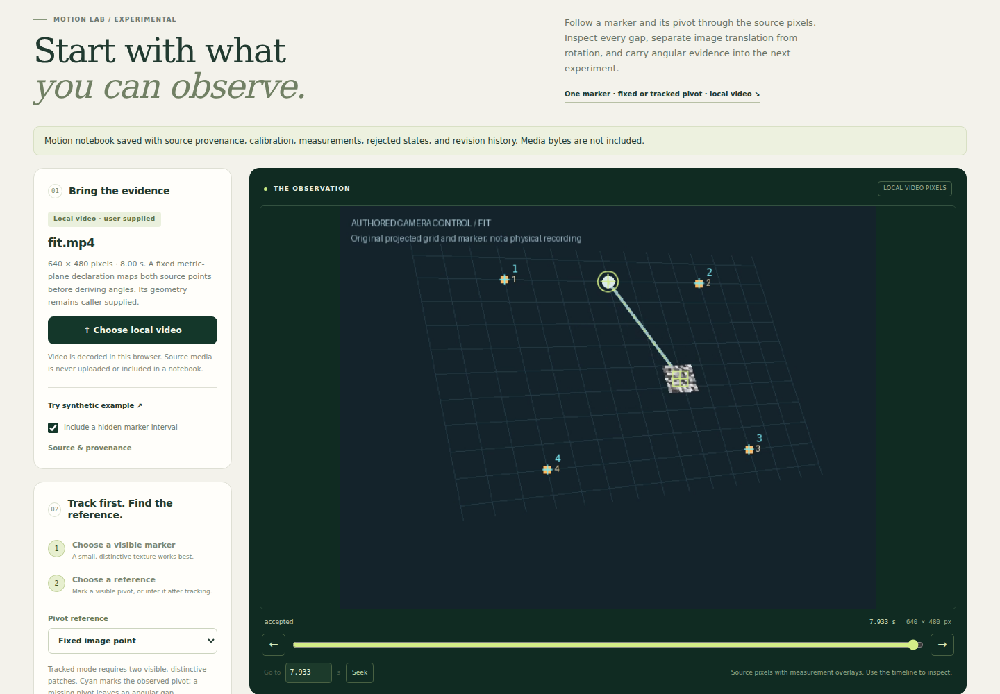
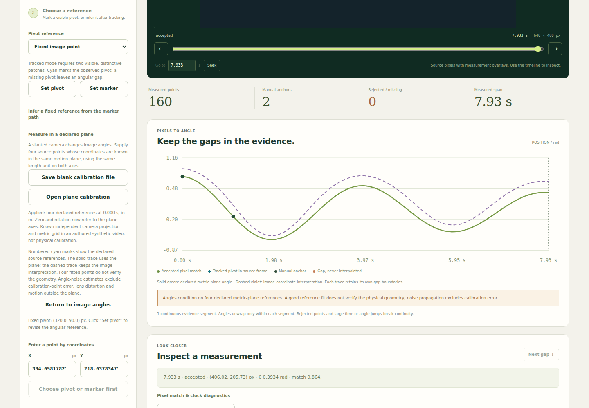
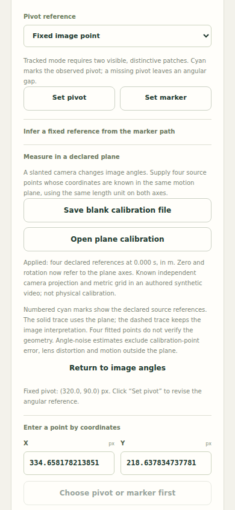
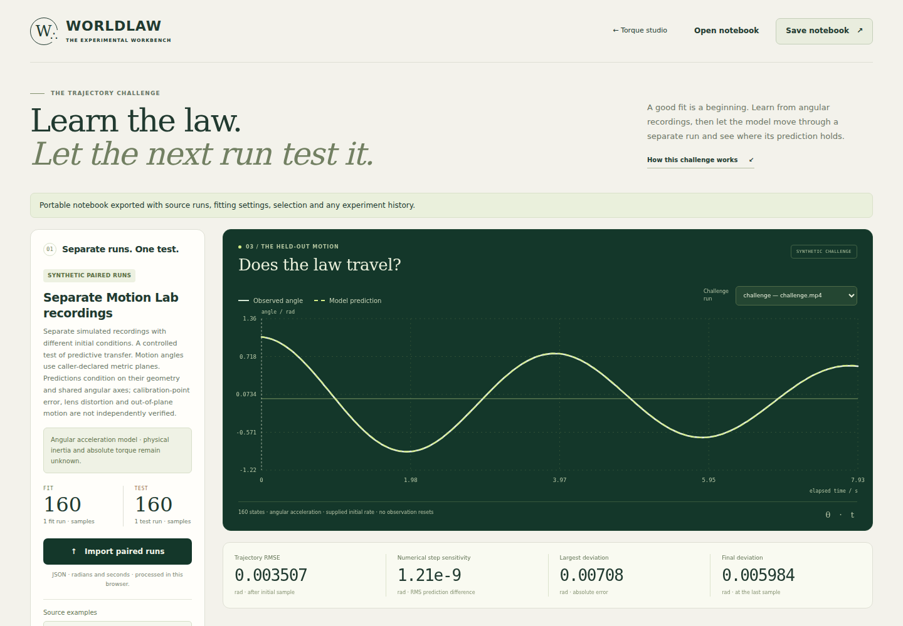

# Angular observations through a declared metric plane

Motion Lab can now interpret an observed marker and pivot through four declared
metric-plane references. This lets its existing angular-law consumer receive a
slanted fixed-camera recording without treating perspective-distorted image
angles as physical angles. Original video pixels, marker/pivot observations,
decoded times, failures and manual revisions remain the evidence.

This is a conditional coordinate transformation. Four matching references do
not establish a physical calibration, the correct aspect ratio, a stationary
camera, negligible lens distortion, or that the mechanism stays in one plane.

## Use it in the running product

1. Start `npm start`, open `/motion.html`, and choose an original local video.
   Set a visible pivot and marker and acquire the observations as before. A
   tracked pivot is also supported for angular measurements; the autonomous
   fixed-pivot law intake still refuses moving pivots.
2. Open **Measure in a declared plane** and save the blank calibration file.
   It contains the original video SHA-256 and decoded dimensions, four blank
   image/plane pairs, and explicit assumptions initially set to `false`.
3. Fill the four source-pixel positions and their independently known planar
   coordinates. Both plane axes must use the same length unit and metric scale.
   Set `referenceTime`, describe the physical or authored basis, and explicitly
   declare all four assumptions only where justified. Points must be nondegenerate.
   A source match does not authenticate the coordinates themselves.
4. Open that file in the same panel. Numbered cyan crosses identify the declared
   references on the original raster. The solid green angle trace uses the
   declared plane; the dashed violet trace retains the image interpretation.
   Each trace keeps its own continuity boundaries. The original frame is not
   resampled or replaced with a synthetic rectified picture.
5. Check the reference point, angle zero, direction, source observations and
   diagnostic warnings. Angle zero is the plane's positive Y axis; positive
   rotation points toward positive X before applying the existing offset and
   direction setting. Applying a plane preserves those numeric settings, so
   review their meaning when changing coordinate frames.
6. Save the Motion notebook or export one explicitly selected continuous angular
   course. **Return to image angles** removes the active map while retaining
   its declaration in calibration history. Reopening a notebook derives the
   map again from its four references and reconnects only matching source media.
7. In `/trajectory.html`, choose two separate Motion notebooks, their courses,
   independently supplied starting rates, and explicit dynamics/common-angle
   declarations. When both use declared planes, their cameras may differ but
   must each remain fixed and their physical angle zero/direction must agree.
   Fitting uses training observations only; the other recording tests free
   forward prediction. The source summary retains the plane qualification.

## Mechanism and maintained ownership

WORLDLAW uses the unchanged MECHANISM `src/plane-homography.js` blob
`5f9ee62ce8e1511c882774303511a7850b535f65`, already consumed by CHRONOS.
[Machine-readable provenance](../src/motion/vendor/plane-homography-source.json)
pins both consumers. The regression suite verifies the exact Git blob hash.
MECHANISM owns the normalized homography fit and its finite-domain/differential
guards; WORLDLAW owns this declaration and measurement adapter.

For source point `p = (x,y)`, let `P = H(p)` be its inhomogeneous plane position.
Both the marker and pivot pass through the same map before subtraction:

```
delta = H(marker) - H(pivot)
angle = direction * (atan2(delta.x, delta.y) - zeroAngle)
```

Mapping only the displacement would be wrong for a projective transformation.
The fixed-pivot and tracked-pivot paths therefore share this same operation.
Unwrapping and gap admission remain the maintained Motion logic. Missing or
rejected pivots never acquire an inferred replacement.

The declared isotropic source-pixel noise propagates through the map's analytic
Jacobian. With `g = (delta.y, -delta.x) / |delta|²` and source Jacobians `Jm, Jp`,
the first-order angle variance is `sigma_m² |Jmᵀg|² + sigma_p² |Jpᵀg|²`.
The second term applies only to tracked pivots. The existing fixed reference
remains exact conditional input. Calibration-point error, fitted-pivot error,
lens distortion, camera movement, and departures from the plane are excluded.
An independent central-pixel-perturbation control checks the differential.

Admission fits from the raw pairs every time, refuses a projective horizon
through the raster, checks the map's differential at source probes, and checks
inverse round trips to within `1e-5` source pixels. These are numerical checks,
not physical validation. Plane coordinates are finite and bounded to ±8,192
common units. Reference time must lie inside the original recording; it is a
declared inspection time, not independently authenticated acquisition evidence.

## Source custody and compatibility

The active declaration uses `worldlaw.metric-plane/v1`. Its source SHA-256 and
decoded dimensions must match the original Motion source exactly. A blank
template is deliberately invalid. Imports larger than 32 KB are refused.
Asynchronous import checks that the notebook and acquisition state have not
changed before applying the result. A bad import leaves the previous notebook
intact; no computed matrix supplied in the file is trusted.

Notebooks with a plane use `worldlaw.motion-notebook/v3`, so older readers
cannot silently apply their old image-angle interpretation. Existing v1 fixed
and v2 tracked notebooks remain supported. Original measurement rows are
unchanged. Angular exports retain the declaration and qualifications. The
existing torque export still requires its explicit dynamics assumptions and
refuses tracked-pivot courses; this work does not identify physical inertia or
absolute torque.

Image-circle reference inference is disabled while a plane is active because
the center of a projected circle is not generally the projected physical pivot.
An already accepted image reference remains declared input and carries its
existing fitted-reference warning. This feature does not independently correct
or validate a previously inferred pivot.

## Executed receiving

The [receiving record](receipts/metric-plane-4f4650/verification.json) pins source,
environment, commands and limitations. The [browser record](receipts/metric-plane-4f4650/browser.json)
contains observed metrics and explicit correction events. Authored movies and
declarations are retained in [the fixture directory](../examples/metric-plane/).
They were rendered from independent projective cameras and a damped oscillator;
they are not captured physical evidence or an independent blind benchmark.

| Original movie | Accepted observations | Explicit tracker corrections | Image-angle RMS error | Declared-plane RMS error |
| --- | ---: | ---: | ---: | ---: |
| `fit.mp4` | 160 | 1 | 0.217078 rad | 0.001424 rad |
| `challenge.mp4` | 160 | 2 | 0.293549 rad | 0.003103 rad |

The original fixed-template tracker and its thresholds were unchanged. It lost
the projected patch at 1.1 s in the first movie, and at 2.433333 s and 3.933333 s
in the second. The receiving operated the existing explicit correction UI using
the known authored control position at each failed frame. Prior failures remain
in revisions. These results qualify angle interpretation conditional on acquired
points; they are not an automatic tracking-quality gain.

At an initial requested 30 Hz, actual decoded intervals alternated between
approximately 33 and 67 ms. The existing 1.6-step rule split the courses and
Trajectory correctly refused them. The final receiving explicitly requested
20 Hz, without widening that rule or interpolating missing frames. Its separate
160-point movies reached the existing model fitter and forward solver. The
training-selected `rate+spring` model obtained 0.003507 rad RMS forward error
on the second movie (initial angle/rate supplied); persistence and initial-rate
references had 1.187530 and 0.926031 rad error on the same non-initial samples.
All notebook export/reopen and source reattachment checks passed.

Further negative controls cover wrong source identity, missing assumptions,
singular references, a projective horizon, gaps, missing tracked pivots, and
forged cached matrices. Crucially, a deliberately incorrect planar aspect ratio
fits all four references almost exactly yet produces over 0.1 rad RMS angle error.
That case stays admitted as a conditional declaration, with its physical limits
visible; the product never interprets its small reference residual as validation.

Four independently authored camera maps and both fixed/moving-pivot courses
exercise the coordinate mechanism. The native suite passed with 975 tests,
one existing optional skip, and zero failures; both launched-product smoke
checks passed. Actual Chromium receiving used namespace and Seccomp-BPF
sandboxing, the desktop and 390 px layouts, keyboard activation/focus and
reduced-motion preference. It observed no page errors or external requests.

Reproduce the fresh movies and receiving with Pillow, ffmpeg, Node and Playwright:

```sh
python scripts/make-metric-plane-fixtures.py .receipts/metric-plane-fixtures
node --test tests/motion-metric-plane.test.mjs tests/motion-intake.test.mjs
npm test
npm run smoke
npm run smoke:trajectory
node scripts/motion-metric-plane-browser.mjs
```

The browser script accepts `PLAYWRIGHT_MODULE`, `BROWSER_EXECUTABLE_PATH`,
`MOTION_FIXTURE_DIR` and `BROWSER_ARTIFACT_DIR`. Use an ordinary unprivileged
browser account with its supported sandbox. Encoder/library versions can change
movie bytes; newly generated declarations bind to their newly generated movies.

## Visible experience

The integration keeps the source mechanism as the object of inspection. A
separate calibration dashboard was considered; the chosen additive panel,
numbered source crosses and paired angle traces let the user compare the
coordinate consequence against the exact same observations in Motion Lab.
It adds no detached viewer or replacement app shell.





