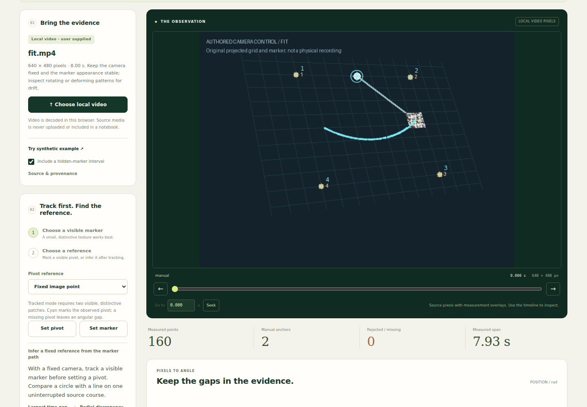
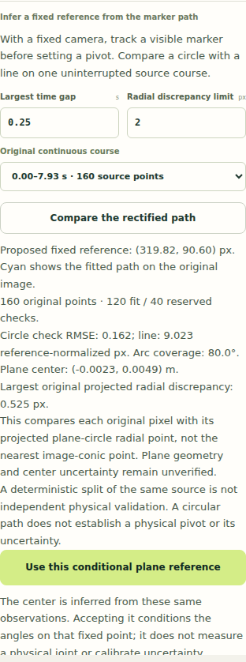

# Infer a conditional reference from a rectified marker path

Motion Lab can fit a hidden fixed reference after the original marker has been
tracked, when the user supplies a source-bound metric-plane declaration. It
reuses the maintained MECHANISM line/circle classifier and homography. The
inferred center is projected back onto the original video, explicitly accepted,
and carried through the existing angular measurement and separate-recording law
workflow. The observed raster, decoded times, missing rows and corrections stay
intact.

This removes the need to enter a visible pivot for a qualified circular course.
It does not establish a physical joint, authenticate a camera calibration, or
estimate the uncertainty of the fitted reference. Every result is conditional on
the declared plane and the same marker observations used to fit that reference.

## Use the maintained page

1. Open `/motion.html`, choose an original local movie, select a stable visible
   marker and acquire its original observations. A pivot is not required for
   acquisition. Correct tracking failures explicitly; gaps are not interpolated.
2. In **Measure in a declared plane**, download and complete the existing
   source-bound declaration. Four original-image points must correspond to
   independently supplied planar coordinates with the same length scale on both
   axes. State the basis and assumptions. See [the plane contract](MOTION_METRIC_PLANE.md).
3. Open the declaration. Without an existing reference it is **staged**: the
   numbered references appear on the original raster, but no pivot or angles are
   invented. A staged declaration alone is not saved as an active calibration.
4. Expand **Infer a fixed reference from the marker path**, choose one original
   continuous course, and declare the largest allowed time gap and projected
   radial discrepancy. Press **Compare the rectified path**. Inspect the fitted
   projected arc, candidate center, original fit/check split and residuals.
5. Apply a supported candidate with **Use this conditional plane reference**.
   The accepted source-pixel pivot and plane then drive the existing angle
   measurement. Review the angle convention and any offsets. Save the version 3
   Motion notebook; reconnecting its original video remains a separate action.
6. If a pivot was observed manually after a declaration was staged, its existing
   image interpretation remains active until **Apply staged plane to current
   reference** is chosen. Independently tracked pivots retain their normal plane
   measurement workflow and cannot be replaced by fixed-reference inference.

Changing the course, gap, discrepancy, plane or original notebook retires a
preview. Applying a proposal recomputes it from the current original rows and
declaration. A late file read cannot alter a newer notebook. Bad inputs preserve
the previously accepted notebook.

## Conditional coordinate mechanism

Let `H` map an original image point into the admitted metric plane. Each original
marker observation is transformed separately, and the unchanged classifier
compares a line with a circle on the selected continuous course. Its deterministic
fit/check split and original model, spread and angular-coverage gates remain in
force. No new points are created across a source gap.

The classifier's numeric units are normalized by the RMS pair distance of the
four original image references divided by their RMS distance in the declared
plane. Its origin is the plane-reference centroid. Because the existing spread
gate uses an axis-aligned box, classifier axes are fixed to the longest original
image-reference pair, with pair ordering resolved by original image coordinates.
That pair's direction in the plane defines an orthonormal basis. This makes a
mere unit conversion, rigid rotation of plane axes or permutation of reference
pairs preserve the intended classification. It does not make incorrect geometry
valid.

The fitted center is transformed back into plane coordinates, then through
`H^-1` to a source-pixel reference. The proposed arc uses 129 samples across the
observed angular span and is drawn over the original raster. The raster itself
is neither resampled nor replaced by a rectified image.

For plane observation `P`, fitted center `C` and radius `r`, the declared
source-pixel discrepancy is

```
distance(originalPixel, H^-1(C + r * (P - C) / |P - C|))
```

This is the inverse projection of a radial plane-circle point. It is **not the
nearest distance to the image conic** and should not be interpreted as such.
The user limit applies to the largest discrepancy across all original course
rows. The course also needs at least 12 source pixels of original image span;
the inferred reference must remain inside the original raster. Classifier fit
and check residuals are reference-normalized units, separately labeled from the
final source-pixel discrepancy.

Acceptance ignores a supplied cached pivot, recomputes the proposal and records
the original source identity, selected original observations and indices,
declaration, settings, normalization, fitted plane circle and interpretation in
the notebook revision history. The raw measurement rows remain unchanged.
Existing version 1/2 notebooks and image-only inference remain supported.

## What the evidence establishes

The [native test](../tests/motion-plane-path-reference.test.mjs) has nine groups:

- Four independently specified cameras recover authored hidden centers; directly
  fitting image circles produces 25–200 px center errors on these controls.
- Independently seeded source-pixel perturbations retain their discrepancies;
  the tested ±0.3px perturbations give 0.043–0.212 px center errors.
- Unit changes, rigid plane-axis rotations and reordered reference pairs preserve
  the source reference, including an independently discovered high-noise gate
  boundary case.
- Short arcs, straight paths, moving-center courses and insufficient source
  evidence remain unresolved rather than acquiring a pivot.
- Original gaps remain boundaries, stale source/plane proposals refuse, forged
  cached pivots are ignored, and save/reopen retains the original conditioning.
- A deliberately wrong metric aspect ratio can remain admitted with less than
  0.3px radial discrepancy while its inferred center is over 20 px wrong. A small
  fit residual is therefore not proof of a correct calibration or reference.

EXPERIMENTAL EARTH independently found the axis-dependent spread gate in an
earlier adapter. The corrected original-image basis passed its original seeded
reproduction and the native groups. SECOND GROUND reviewed staging, original
source custody and delayed reads; its observed-reference wording finding was
fixed and received through the actual page. These are independent agent reviews,
not additional human approvals or physical measurements.

## Actual original-video receiving

The maintained browser runner acquires the two original authored MP4s already
retained under [examples/metric-plane](../examples/metric-plane/). It stages the
declaration before a pivot exists, selects and tracks the visible marker through
the unchanged NCC tracker, operates the existing explicit correction controls,
compares the rectified path and accepts its reference by keyboard. It then saves
and reopens the raw notebooks, refuses a different source, reconnects the exact
original movie, checks the 390 px layout and executes the separate-recording law
consumer.

The authored rasters show their mechanism, but no pivot position is supplied to
this workflow. This is an original-marker inference control, not a natural-video
occlusion benchmark.

| Original movie | Original accepted rows | Explicit tracker corrections | Inferred center error | Plane-angle RMS error | Image-angle RMS error |
| --- | ---: | ---: | ---: | ---: | ---: |
| `fit.mp4` | 160 | 1 | 0.624879px | 0.002215rad | 0.219300rad |
| `challenge.mp4` | 160 | 2 | 1.376650px | 0.003215rad | 0.294629rad |

The authored generator is a rate-plus-spring oscillator. The downstream
training-selected model was `rate+coulomb+spring`, with 0.017641 rad forward RMS
error on the separate movie and complete rollouts. **The extra Coulomb term is
absent from generator truth.** This is an informative model-selection limitation,
not successful recovery of the true law. The earlier known-pivot control had
0.003507 rad forecast RMS error; the new workflow makes no improvement claim over
that supplied-reference result.

Both recordings' centers were inferred from their own original marker rows
before law comparison. Law coefficients and ranking still use the training
recording only, but the challenge's reference preprocessing is not independent
of its own path. A deterministic within-course fit/check split is also not an
independent physical validation. The current angle-noise propagation conditions
on the fitted center and plane as exact; their estimation errors are excluded.

Source SHA256 values:

- `fit.mp4`: `5a27a92fe35d38e54f303b8299693f630223c6d252076b52820cb4e302e66d7c`
- `challenge.mp4`: `1740ff6d082d562f7b35bbb1d28e6eaaf5f0de1198d23721fb369912a59ad3c9`

The [verification record](receipts/plane-reference-4f4650/verification.json),
[eight-group browser record](receipts/plane-reference-4f4650/browser.json),
[three-group state record](receipts/plane-reference-4f4650/state-browser.json)
and raw saved notebooks retain the exact observations and boundaries. Browser
execution uses an ordinary unprivileged user, Chromium's namespace and
Seccomp-BPF sandboxes, local source files and no external requests.

```sh
node tests/motion-plane-path-reference.test.mjs
node --test tests/motion*.test.mjs tests/trajectory*.test.mjs tests/forced-weak-discovery.test.mjs
INFER_PLANE_REFERENCE=1 node scripts/motion-metric-plane-browser.mjs
node scripts/motion-plane-reference-state-browser.mjs
```

Both browser scripts accept `PLAYWRIGHT_MODULE`, `BROWSER_EXECUTABLE_PATH`,
`BROWSER_ARTIFACT_DIR` and `MOTION_FIXTURE_DIR`. The state script takes the prior
runner's original uncalibrated notebooks through `MOTION_INPUT_DIR`. Package
generation keeps the current distribution policy and explicitly requires the new
adapter. Working-tree archives remain labeled candidates unless their exact
source tree has separately been verified.

## Visible experience

Two experiences were considered: a separate rectified-coordinate study, and an
inferred arc on the existing original-video stage. The original-stage approach
was chosen so the source pixels, declared references, measured points and
proposed center can be inspected together. Explicit comparison and acceptance
sit beside the existing marker/reference controls. Desktop and narrow captures
were inspected; the controls retain keyboard operation, and their qualification
text uses a readable contrast and size.



